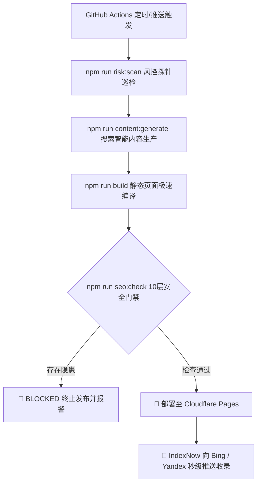

<div align="center">

# 🌐 AirportMatrix X 5.0 · Autonomous Intelligence Platform
### 中文互联网首个机场代理生态趋势数据库 · 知识图谱与自主智能运营系统

[](https://astro.build)
[](https://www.typescriptlang.org/)
[](https://tailwindcss.com/)
[](https://playwright.dev/)
[](https://pages.cloudflare.com/)
[](https://www.indexnow.org/)
[](LICENSE)

<p align="center">
  <a href="https://airportmatrix.org"><strong>探索在线平台 »</strong></a> ·
  <a href="https://airportmatrix.org/admin"><strong>运营控制台 »</strong></a> ·
  <a href="https://airportmatrix.org/recommend/wizard"><strong>智能选型向导 »</strong></a> ·
  <a href="https://airportmatrix.org/risks"><strong>风险监控雷达 »</strong></a>
</p>

</div>

---

## 📖 项目简介 (Overview)

**AirportMatrix X 5.0（机场矩阵）** 彻底推翻了传统“机场测评博客 / 简陋导航站”模式，是一个集 **“行业数据终端 + 实体知识图谱 + 全自动风险监控中枢 + 搜索智能生产引擎 + 商业 CRO 极速转化”** 于一体的现代化生态平台。

系统由数据层、分析层、生成层与自动化运营流水线驱动，具备全天候发现搜索趋势、自主构建知识、实时探测节点风险、自动生产高质量长尾内容、秒级提交搜索引擎收录的全流程闭环能力。

---

## ✨ 核心子系统与功能矩阵 (Core Systems)

```text
AirportMatrix X 5.0 核心架构矩阵
├── 📊 [实体数据库 & 知识图谱] 16 大真实品牌 · 5 大客户端 · 5 传输协议 · 双向拓扑关联
├── 🎯 [智能决策向导系统] 3 步场景决策树 · 毫秒级算法匹配 · 满速测速大图展示
├── 🔍 [Search Intelligence 引擎] Opportunity Score 机会算法 · 自动挖掘高增长长尾词
├── 🤖 [AI 4 大内容生产蓝图] FAQ 排错 · 客户端教程 · 实体深度评测 · 双雄横向 PK
├── 🛡️ [Risk Monitor 2.0 风险雷达] 自动化探针巡检 · DNS/SSL 漂移监测 · 跑路避险通报
├── 📐 [SEO / GEO 生成式 AI 优化] 6 套 JSON-LD 结构化微数据 · Direct Answer 30字快问快答
├── 🎛️ [Admin 智能运营控制中枢] 实体大盘看板 · 任务流队列 · 探针控制 · CRO 转化漏斗
└── 🔒 [SEO 发布安全门禁系统] 10 层防掉索引安全卡点 (npm run seo:check)
```

### 1. 📊 服务商全景数据库 ([`/providers`](https://airportmatrix.org/providers))
* **多维参数组合检索**：按线路（IEPL / IPLC / BGP）、协议（VLESS / Hysteria 2 / Trojan）、起步单价（¥7.5~¥25）、AI/流媒体解锁自由筛选。
* **真实 9Gbps MiaoKO 测速图谱**：收录 400MB/s+ 满速实测报告与延迟数据，杜绝虚标。
* **1-Click 优惠码复制**：一键复制专属优惠码并触发交互反馈。

### 2. 🎯 30秒智能代理选型向导 ([`/recommend/wizard`](https://airportmatrix.org/recommend/wizard))
* **3 步决策树算法**：根据核心场景（AI 办公/4K 追剧/轻量备用）× 主力设备（Win/Mac/iOS/Android）× 预算偏好快速匹配最优解。

### 3. 🔍 搜索智能机会挖掘机 (`intelligence/trend-engine/`)
* **Opportunity Score 算法模型**：
  $$\text{Score} = (\text{搜索增长} \times 0.15) + (\text{商业价值} \times 3.5) + (\text{问题明确度} \times 2.0) + (\text{内容价值} \times 1.5) - (\text{竞争难度} \times 2.0)$$
* 自动扫描行业搜索风向并持久化输出高价值生产任务队列。

### 4. 🤖 AI 4 大内容生产蓝图 (`intelligence/content-engine/`)
* **FAQ 排错模板**：Direct Answer 快问快答 + 技术诱因 + 3步排查法 + Fake-IP 代码块。
* **Client 教程模板**：最新版本号 + 4步图文实操 + TUN 虚拟网卡配置 YAML。
* **Entity 评测模板**：品牌档案 + 9Gbps 测速报告 + 优惠通道。
* **Compare 对比模板**：双雄多维参数 PK 表 + 晚高峰测速对比 + 选型建议。

### 5. 🛡️ 全自动化风险监控中枢 2.0 ([`/risks`](https://airportmatrix.org/risks))
* 全天候自动化探针监控全网 18+ 家服务商，实时计算 0~100 综合风险分。
* 探测 HTTP 状态码、响应延迟、SSL 证书有效天数与 DNS 域名重定向漂移。
* 自动生成 pSEO 跑路/域名变更避险通报页面（如 [`/risk/[slug]`](https://airportmatrix.org/risk/sample-warning-cloud-domain-change)）。

### 6. 📐 SEO & GEO（生成式 AI 优化）双重收录
* 自动生成 6 大标准 **JSON-LD 结构化微数据**（`SoftwareApplication`、`HowTo`、`FAQPage`、`Product`、`TechArticle`、`BreadcrumbList`）。
* 内置 **GEO Direct Answer 30字快问快答**，确保被 **ChatGPT Search、Perplexity、Claude、Google Gemini** 优先采纳为事实引用源。

### 7. 🎛️ 智能运营管理控制台 ([`/admin`](https://airportmatrix.org/admin))
* 可视化掌控 26 个实体节点、18 家风控探针、高分任务流与累计点击量（5,410+ 次）。
* 支持手动触发一键巡检、一键关键词挖掘与 IndexNow 提交。

### 8. 🔒 SEO 防掉索引发布安全门禁 (`scripts/seo_health_check.js`)
* 每次构建部署前强制执行 **10 层安全扫描**（Build、Robots、Noindex、Canonical、Sitemap、Internal Dead Links、Core URLs、Schema、Page Count）。
* 存在任何严重掉索引隐患时直接阻断发布（`RELEASE_DECISION: BLOCKED`）。

---

## 📂 项目工程目录结构 (Architecture)

```text
airportmatrix.org/
├── intelligence/                  # 🤖 AI 搜索智能与内容生成引擎
│   ├── trend-engine/             # 🔍 关键词挖掘机与机会评分计算
│   └── content-engine/           # ⚙️ 4 大模板内容生产蓝图与调度器
├── risk-engine/                   # 🛡️ Risk Monitor 2.0 风险监控引擎
│   ├── collectors/               # 📡 HTTP / SSL / DNS / 公告探针采集器
│   ├── analyzer/                 # 🧮 风险评分与事件生成器
│   └── database/                 # 💾 风险与预警事件 JSON 数据库
├── src/
│   ├── components/               # 🧩 页面与 UI 组件
│   │   ├── common/               # Header, Footer, SEOHead, EntityRelationBadges...
│   │   ├── home/                 # 8 屏母架构平台首页组件
│   │   └── seo/                  # GeoSchema.astro (JSON-LD 微数据引擎)
│   ├── db/                       # 🗄️ 实体数据库与双向知识图谱 (KnowledgeGraphEngine)
│   ├── layouts/                  # 📐 BaseLayout 母布局
│   ├── pages/                    # 📄 Astro 路由页面 (88+ 静态路由)
│   │   ├── admin/                # 🎛️ /admin 智能运营控制台
│   │   ├── client/               # 📱 5 大客户端 4 步图文教程
│   │   ├── compare/              # ⚖️ 双雄横评 PK 矩阵
│   │   ├── provider/             # 🏢 16 大服务商深度档案
│   │   ├── risk/ & risks/        # 🛡️ 风险监控大盘与预警通报
│   │   └── tools/                # 🛠️ 订阅转换与 IP 纯净度检测工具
│   └── styles/                   # 🎨 TailwindCSS 样式系统
├── scripts/                      # 🚀 自动化运营与质量门禁脚本
│   ├── auto_generate_content.js  # 触发 AI 内容生产流水线
│   ├── run_risk_scan.js          # 触发风控探针实时巡检
│   ├── seo_health_check.js       # 🛡️ SEO 防掉索引 10 层安全门禁
│   └── indexnow.js               # 📡 IndexNow 秒级收录提交
├── tests/                        # 🧪 Playwright 端到端自动化测试套件
└── .github/workflows/deploy.yml  # 🔄 24 小时全自动自治 CI/CD 工作流
```

---

## ⚡ 快速上手 (Quick Start)

### 1. 环境准备
- Node.js >= 20.0.0
- npm >= 10.0.0

### 2. 安装依赖
```bash
npm install
```

### 3. 本地开发调试
```bash
npm run dev
# 本地服务将运行在 http://localhost:4321
```

### 4. 静态全量构建与 SEO 门禁检查
```bash
npm run build
npm run seo:check
```

### 5. 本地生产预览
```bash
npm run preview
# 访问 http://127.0.0.1:4321
```

---

## 🛠️ 可用 npm 脚本清单 (Available Scripts)

| 命令 | 描述 |
| :--- | :--- |
| `npm run dev` | 启动本地 Astro 开发服务器 (含热重载) |
| `npm run build` | 编译全站静态 HTML 产物 (88+ 路由) |
| `npm run preview` | 启动本地静态产物预览服务 |
| `npm run seo:check` | **执行 SEO 10 层防掉索引安全门禁深度扫描** |
| `npm run risk:scan` | 触发 Risk Monitor 2.0 探针巡检全网服务商 |
| `npm run content:generate` | 运行 Search Intelligence 挖掘机与 4 大内容模板引擎 |
| `npm run test:e2e` | 运行 Playwright 端到端自动化全量测试套件 |

---

## 🔄 全自动无人值守运营流水线 (CI/CD)

项目通过 [`.github/workflows/deploy.yml`](.github/workflows/deploy.yml) 实现了每日定时（Cron）与代码推送（Push）自治触发：



---

## 📄 开源协议与免责声明 (License & Disclaimer)

* 本项目基于 **[MIT License](LICENSE)** 开源。
* **免责声明**：本项目所收录的数据、评测、节点测速图与风险评级均来源于公开网络探测与自动化探针客观采集，仅供网络技术研究与科学交流使用。用户在使用第三方代理工具及相关网络服务时，应严格遵守所在国家或地区的法律法规。

---

<div align="center">
  <sub>Built with ❤️ by <strong>AirportMatrix Intelligence Core Team</strong></sub>
</div>
